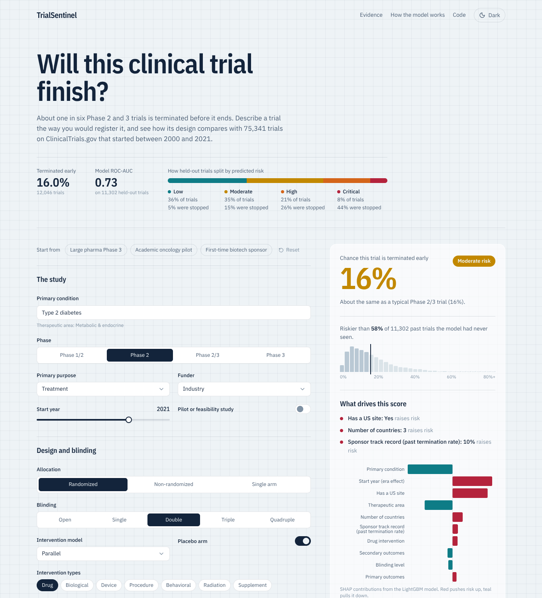
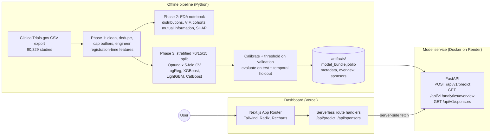

# TrialSentinel

**Will this clinical trial finish?** About one in six Phase 2 and Phase 3 trials is terminated before it
ends. TrialSentinel scores a trial design for its risk of early termination, using only what is known on the
day it is registered, and explains every score with SHAP.

It is trained on 75,341 interventional trials from ClinicalTrials.gov that started between 2000 and 2021.

| | |
|---|---|
| **Live demo** | `https://trialsentinel-kjqp.vercel.app/` *(add after deploying, see [DEPLOY.md](DEPLOY.md))* |
| **API docs** | `https://trialsentinel-api.onrender.com/docs` |
| **Kaggle notebook** | `https://www.kaggle.com/code/your-username/trialsentinel` |
| **Notebook in repo** | [`notebooks/trialsentinel_eda_and_model.ipynb`](notebooks/trialsentinel_eda_and_model.ipynb) |



## Problem statement

A terminated trial wastes years of work and millions in funding, and it exposes patients to an experiment
that answers nothing. Many terminations trace back to design choices made before the first patient enrolled:
an unrealistic site footprint, a single-arm design where randomization was feasible, a sponsor stretched
beyond its track record.

TrialSentinel turns 20 years of registry data into a **design stress-test**. A researcher, sponsor or ethics
committee describes a planned trial and gets:

* the calibrated probability that a trial like this is terminated early,
* where it ranks among 11,302 held-out historical trials,
* the factors pushing its risk up or down.

## Results

Held-out test set (11,302 trials, never used for training, tuning or calibration):

| Metric | Value | Context |
|---|---|---|
| ROC-AUC | **0.731** | 0.5 is random |
| PR-AUC | **0.342** | random guessing scores 0.160 (the termination rate) |
| Macro F1 | 0.627 | at the threshold that maximizes macro F1 on validation (0.25) |
| Top-decile lift | **2.6×** | the riskiest 10% of trials were stopped 2.6× as often as average, catching 26% of all terminations |
| Brier score | 0.121 | probabilities are calibrated (Platt sigmoid on the validation set) |
| Temporal ROC-AUC | 0.681 | trained on 2000–2014 starts, tested on 2017–2021 starts |

| Model | Optuna trials | CV PR-AUC | CV ROC-AUC | Validation PR-AUC | Validation ROC-AUC |
|---|---|---|---|---|---|
| Logistic regression (ElasticNet) | 12 | 0.289 | 0.685 | 0.286 | 0.689 |
| XGBoost | 25 | 0.334 | 0.721 | 0.337 | 0.726 |
| LightGBM **(selected)** | 28 | 0.336 | 0.722 | 0.338 | 0.729 |
| CatBoost | 10 | 0.335 | 0.721 | 0.335 | 0.726 |

Observed termination rate by predicted tier on the test set: Low 5.5% / Moderate 14.7% / High 25.7% / Critical 43.9%.

Selected model: **LightGBM**. Imbalance handling: no reweighting (CV PR-AUC 0.331) and class weights (0.329) were statistically tied and SMOTE-NC was worse (0.326), so the trees train on the natural class balance and calibration handles the probabilities.

**Honest caveats.** A ROC-AUC near 0.7 is a useful screening signal, not a crystal ball. Many terminations
are business decisions, funding gaps or slow recruitment that no registration field can see. The temporal
test shows some drift: termination rose from about 14% of trials started before 2015 to 21% of trials started
2017–2021. Part of that rise is real, and part is right-censoring (long trials started recently are still
running and absent from the export, which inflates the terminated share), so scores for recent designs carry
more uncertainty.

## What drives termination

Mean absolute SHAP on held-out trials:

| Rank | Feature | Mean \|SHAP\| |
|---|---|---|
| 1 | Has a US site | 0.272 |
| 2 | Primary condition | 0.193 |
| 3 | Registration lag (days after start) | 0.185 |
| 4 | Therapeutic area | 0.173 |
| 5 | Sponsor track record (past termination rate) | 0.161 |
| 6 | Start year (era effect) | 0.109 |
| 7 | Drug intervention | 0.085 |
| 8 | Site dispersion index | 0.080 |
| 9 | Sponsor experience (prior trials) | 0.078 |
| 10 | Number of sites | 0.076 |

Notable findings from the EDA:

* **Oncology** trials terminate at 23%, far above every other therapeutic area.
* **Sponsor track record** is the clearest behavioural signal. Sponsors whose earlier trials were often stopped
  keep stopping trials (about 11% for the best-performing sponsors, 24% for the worst). It is measured *time-respectingly*: only
  trials that finished before the new one started count.
* **Single-arm and dose-escalation (sequential)** designs stop far more often than randomized parallel trials.
* **Registration timing** matters. Trials registered before they start terminate more often than trials
  registered months after starting. Retrospective registration partly reflects survivorship (trials that
  reach registration late have already survived their riskiest period), so treat this signal with care.

## The leakage trap

The export's `Enrollment` column looks like the best predictor available, and it is unusable. For finished
trials the registry replaces the planned target with the **actual** number of patients: terminated trials
show a median of 24 patients against 90 for completed ones, *because* they stopped. Any model using it scores
brilliantly offline and fails on a trial that has not started. TrialSentinel also excludes completion dates,
results flags, document uploads and last-update dates. This is the most common flaw in published work on this
problem.

## Architecture



## Methodology

**Phase 1: data and features** (`src/trialsentinel/data.py`, `features.py`)

* Removes 106 near-duplicate registrations of the same protocol, 1,105 trials with missing or impossible start
  dates, 4,638 withdrawn trials (stopped before enrolling anyone, a different outcome) and trials outside the
  2000–2021 window (later trials are mostly still running, so the finished ones are a biased sample).
* Caps outliers at IQR fences (k = 3), widened to the 1st/99th percentile for zero-IQR columns.
* Engineers 35 registration-time features: design (phase, allocation, blinding, model, purpose, placebo),
  population, intervention types, footprint (sites, countries, US site, collaborators), sponsor history,
  registration timing, condition (keyword taxonomy into 16 therapeutic areas, plus the free-text primary
  condition with 14,000+ values) and four composite indicators (site dispersion index, outcome burden, eligibility
  breadth, design rigor score).
* Imputation: explicit `Unknown` for categoricals, median for skewed counts, **IterativeImputer (MICE) with
  missing-indicator columns** for the not-at-random gaps (sites not listed, sponsor without history).
* Encoding: one-hot for low-cardinality categoricals, **cross-fitted target encoding** for primary condition.
  Scaling: RobustScaler on log-transformed counts, StandardScaler on the rest.
* Multicollinearity: iterative **VIF > 5** filter, removing engineered composites before the raw features they
  were built from.

**Phase 3: modeling** (`src/trialsentinel/train.py`)

* Stratified 70/15/15 train/validation/test split.
* Imbalance strategy chosen by experiment: no reweighting vs class weights vs **SMOTE-NC**. SMOTE-NC was
  slightly worse than both, a common result for tree ensembles; the logistic baseline uses class weights.
* **Optuna** (TPE sampler, median pruning) over **5-fold stratified CV**, maximizing PR-AUC, for an ElasticNet
  logistic regression baseline, XGBoost, LightGBM and CatBoost. Preprocessing is refit inside every fold.
* The best model on validation PR-AUC is calibrated on the validation set; the decision threshold maximizes
  macro F1 on validation; final numbers come from the untouched test set.
* SHAP TreeExplainer gives global importance (notebook, dashboard) and per-trial explanations (API).

## API

```bash
curl -X POST https://trialsentinel-api.onrender.com/api/v1/predict \
  -H "content-type: application/json" \
  -d '{"phase":"PHASE2","funder_type":"INDUSTRY","allocation":"RANDOMIZED","intervention_model":"PARALLEL",
       "primary_purpose":"TREATMENT","masking":"QUADRUPLE","sex":"ALL","age_groups":["ADULT","OLDER_ADULT"],
       "primary_condition":"Non-small cell lung cancer","intervention_types":["DRUG"],"has_placebo":true,
       "n_interventions":2,"n_sites":40,"n_countries":6,"has_us_site":true,"n_collaborators":0,
       "n_conditions":1,"n_primary_outcomes":1,"n_secondary_outcomes":5,"sponsor_prior_trials":60,
       "sponsor_prior_termination_rate":0.15,"registration_lag_days":10,"start_year":2021}'
```

Returns the calibrated probability, risk tier (Low < 10% ≤ Moderate < 20% ≤ High < 35% ≤ Critical), relative
risk versus the base rate, the top 3 risk drivers and every feature's SHAP contribution. Inputs are validated
by strict Pydantic schemas: enumerated categories, numeric bounds, unknown fields rejected, and cross-field
rules (countries cannot exceed sites, a placebo arm needs randomization, a sponsor with no prior trials has no
track record).

| Endpoint | Purpose |
|---|---|
| `POST /api/v1/predict` | Score one trial design |
| `GET /api/v1/analytics/overview` | Cohort statistics, model metrics, risk tiers, global importance |
| `GET /api/v1/sponsors?q=` | A sponsor's historical trial count and termination rate |
| `GET /api/v1/options` | Allowed values for every categorical input |
| `GET /health` | Liveness check |

## Reproduce it

```bash
# 1. Python environment
poetry install --with api,dev           # or: pip install -e . && pip install -r api/requirements.txt
# 2. Data: follow data/README.md to download the export to data/raw/ctg-studies.csv
# 3. Pipeline
poetry run make data          # Phase 1, ~1 min
poetry run make train         # Phase 3, ~40 min on 2 CPU cores (make train-quick for an 8-min smoke test)
poetry run make onnx          # optional ONNX export with parity check
poetry run make analytics     # overview.json for the API and dashboard
poetry run make notebook      # Phase 2, executes the notebook and writes reports/figures/
poetry run make test          # API tests
# 4. Run locally
poetry run make api           # http://localhost:8000/docs
cd web && npm install && API_URL=http://localhost:8000 npm run dev    # http://localhost:3000
# or both at once
docker compose up --build
```

Seeds are fixed (`RANDOM_STATE = 42`), so the split, folds and Optuna search are repeatable on the same data.

## Repository layout

```
src/trialsentinel/    config, feature engineering, cleaning, preprocessing, training, analytics
api/                  FastAPI app, Pydantic schemas, tests, Dockerfile
web/                  Next.js dashboard (App Router, TypeScript, Tailwind, Radix, Recharts)
notebooks/            EDA + modeling notebook (Kaggle-ready)
artifacts/            trained model bundle (+ ONNX export) and JSON outputs served by the API
reports/figures/      figures exported by the notebook
data/                 raw and processed data (git-ignored; see data/README.md)
```

## Limitations

* Trained on what the registry records. Recruitment progress, funding and business strategy, the reasons
  behind many terminations, are invisible to it.
* The public export has no planned enrollment and no eligibility-criteria text. Both would likely add signal
  and are the natural next step (via the ClinicalTrials.gov API or the AACT database).
* A score is a prompt to question a design, never a verdict on a trial or its science. Not for regulatory or
  medical decisions.

## Data and license

Data: ClinicalTrials.gov, U.S. National Library of Medicine (public domain). Code: MIT.
